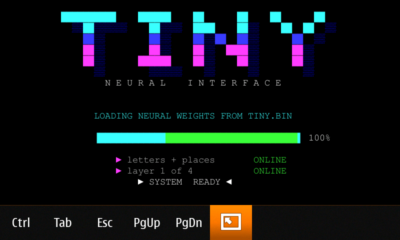
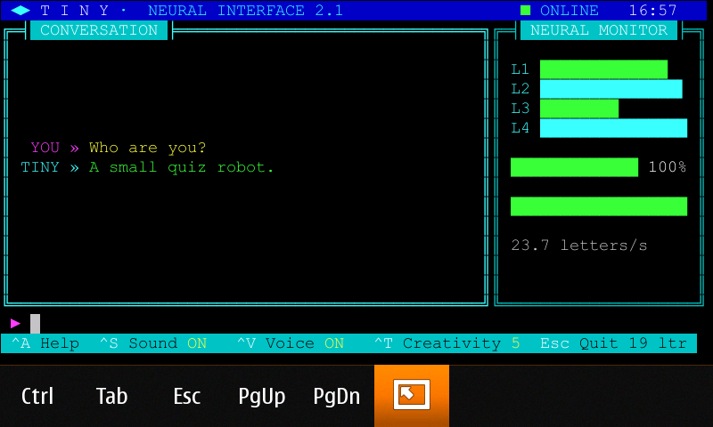
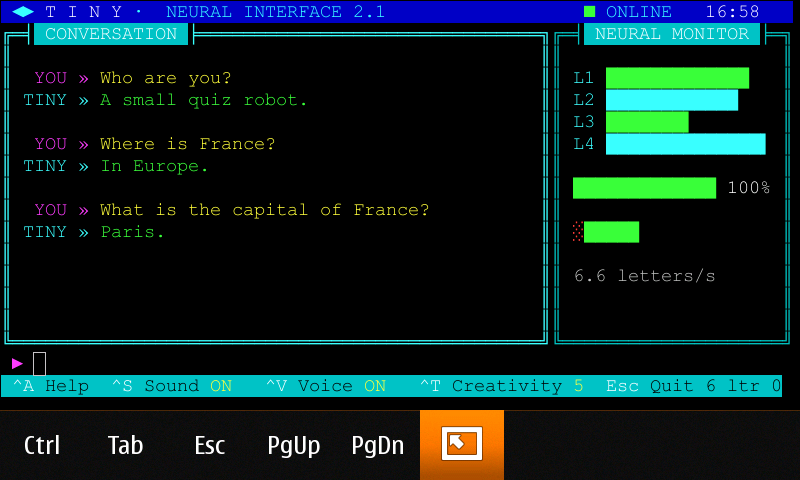

# TINY on the Nokia N900 (branch `n900`)

This branch builds TINY 2.1 on a POSIX system, in particular for the Nokia N900 (Maemo 5, ARM, glibc 2.5), with the full-screen interface:

- `conio_ncurses.c` / `conio_ncurses.h` provide the DOS `conio` functions that `TINY.C` uses (screen, colours, keys) on top of ncurses (a virtual 80x25 screen, drawn with wide characters).
- `TINY.C` has small changes: the interface is built when `HAVE_UI` is defined (Turbo C, or `-DCONIO_NCURSES`), the palette is set with ncurses, and the function keys F1..F4
  are also on Ctrl-A, Ctrl-S, Ctrl-V and Ctrl-T (a phone keyboard has no F-keys).
- **Sound:** the PC speaker is not on the phone, so the tones of TINY (the keys, the robot voice) are played as a square wave through `paplay` (a pipe, a WAV stream of unknown length). It has to be `paplay`: the sound policy of the N900 limits the volume of programs it does not know to about 30 % (-30 dB) unless the stream asks for its volume itself when it connects, as `paplay` does. `delay()` writes the tone into the pipe and waits as long as it lasts, so the voice and the picture keep step (the player adds about a quarter of a second of delay). `TINY_SILENT=1` or a missing `paplay` gives silence. See *Keys and volume* below for the volume. `TINY_AUDIO_LOG` and `TINY_AUDIO_DUMP` are for testing (not in `/tmp`, it is only 1 MB on the phone).
- **The layout follows the size of the terminal** (`layout()` in `TINY.C`; the DOS version is still 80 x 25): the frames, the chat window, the neural monitor (the compact one when there are fewer than 18 rows),
  the line for the question (framed only from 24 rows), the status bar and the boot screen are computed from the columns and rows. It was tried at 72x16 and 72x18 (the N900 terminal with its normal font, windowed and full screen) and at 80x25.
  The terminal needs at least 60 x 14 characters; with a smaller one `tiny` says so, and `tiny /P` is the plain text mode.
- The terminal should have 256 colours (`TERM=xterm-256color`) for the neon palette; with fewer, the nearest standard colours are used.

## Keys and volume

| Key | What it does |
|---|---|
| Enter | ask the question |
| **PgUp / PgDn** | **volume up / down** (ten levels; the buttons PgUp and PgDn in the toolbar of the terminal of the phone). The status bar shows `volume N/10` and a short sample plays. The level is remembered in `~/.tiny-volume` (the default is 3, which is quiet) |
| Ctrl-A | help (F1 in DOS) |
| Ctrl-S | sound on / off (F2) |
| Ctrl-V | robot voice on / off (F3) |
| Ctrl-T | creativity 0 to 9 (F4) |
| Up arrow | the last question |
| Esc | quit |

The volume of TINY is separate from the volume of the phone. The sound policy of the N900 would cut a program it does not know to about 30 % (-30 dB), so TINY asks for the full volume of its stream (through `paplay`) and keeps its own level: it does not follow the volume buttons of the phone.
`TINY_VOLUME=1..10 tiny` sets the level for one run only, `TINY_SILENT=1` turns the sound off.

## On the N900

Screenshots from a Nokia N900 (800 x 480, the terminal in full screen, 72 x 18 characters):

Build: `make` (see the top of the `Makefile`). Packages for the N900: <https://n900-resurrection.github.io>.
